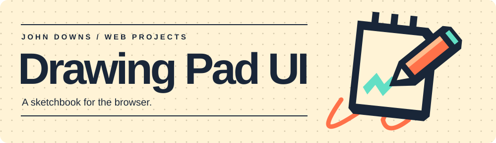

<p align="center"></p>

# Drawing Pad UI

A browser-based drawing pad built with **HTML, CSS, and JavaScript**. The idea is simple. Open a page, put down a line, and see where it takes you.

[Getting started](#getting-started) · [Design notes](#design-notes) · [Favicon setup](#favicon-setup) · [Credits](#credits)

## Getting started

Open the project's HTML entry page in a browser. For local development in VS Code, open the project folder and launch the entry page with Live Server if you use that extension.

## Design notes

The project mark pairs a spiral-bound pad with a diagonal pencil. A small mint zigzag gives the page its first stroke. The README cover carries the same palette onto dotted sketch paper.

| Ink | Paper | Pencil | First stroke |
| --- | --- | --- | --- |
| Midnight • `#192638` | Cream • `#FFF3D6` | Coral • `#FF7149` | Mint • `#62DFC5` |

## Favicon setup

Place `favicon.svg` and `favicon.ico` beside your HTML entry page. Add these lines inside its `<head>` element.

```html
<link rel="icon" href="./favicon.ico" sizes="16x16 32x32 48x48 64x64 128x128 256x256">
<link rel="icon" href="./favicon.svg" type="image/svg+xml" sizes="any">
```

Keep the `assets` folder beside this README so GitHub can display the cover.

## Credits

Project by **John Downs**. The README text, cover illustration, and favicon artwork are available under [CC BY 4.0](https://creativecommons.org/licenses/by/4.0/). See [the attribution file](ATTRIBUTION.md) for a reusable credit line.
